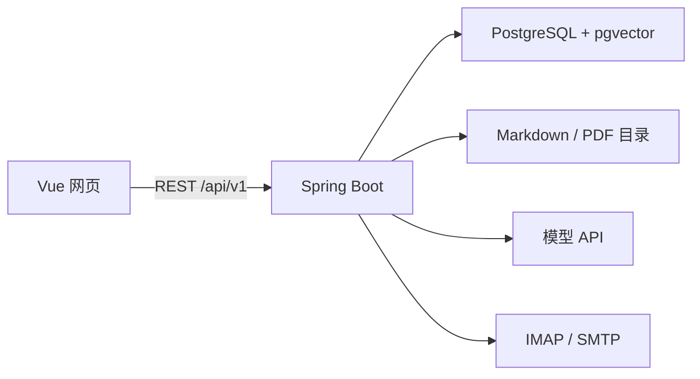

# 个人学习助手

把 Markdown 和 PDF 放进资料目录，就可以在网页里向资料提问、点开引用核对原文，以及在电脑和手机上接着读。也可以接入邮箱，根据来信和资料起草回复，确认后发送。

## Docker Compose 启动

在项目根目录把 `.env.example` 复制为 `.env`，填写登录口令、数据库密码和模型密钥，并将 `ASSISTANT_DOCUMENTS_DIR` 指向已存在的资料目录。口令至少 12 个字符，包含大小写字母、数字和符号，BCrypt 上限为 72 个 UTF-8 字节。Docker Compose 需要 v2.24 或更新版本。

```powershell
Copy-Item .env.example .env
docker compose up -d --build
```

编辑 `.env` 后再执行第二条命令。Compose 会构建应用、启动 PostgreSQL 并自动迁移。打开 `http://127.0.0.1:8080`，默认用户名为 `learner`。资料和已配置的邮箱会在后台同步，页面也会自动刷新列表。已有 Compose 部署时，将 `COMPOSE_PROJECT_NAME` 设为原项目名，以继续使用原数据库卷。

## 直接运行 JAR

准备 JDK 21、Maven 3.9、Node.js 22.13 或更新的 LTS 版本，以及启用了 pgvector 的 PostgreSQL。以下示例在同一 PowerShell 窗口中运行。

```powershell
$env:ASSISTANT_PASSWORD = '替换为你的登录密码'
$env:ASSISTANT_DOCUMENTS = 'D:\学习资料'
$env:ASSISTANT_DB_PASSWORD = '替换为你的数据库密码'
$env:ASSISTANT_MODEL_KEY = '替换为你的模型 API 密钥'
$env:ASSISTANT_SECURE_COOKIE = 'false'

docker compose up -d postgres
npm --prefix frontend ci
npm --prefix frontend run build
mvn package
java -jar target/learning-assistant-0.1.0.jar
```

已有数据库时，通过 `ASSISTANT_DB_URL`、`ASSISTANT_DB_USER` 和 `ASSISTANT_DB_PASSWORD` 连接。JAR 从启动进程的环境读取配置。变量用途和示例见 [`.env.example`](.env.example)。

## 接入邮箱

Gmail、Outlook.com 的主机、端口、TLS 和凭据示例见[邮箱配置](docs/邮箱配置.md)。

## 从手机访问

用 HTTPS 反向代理把访问请求转发到 `127.0.0.1:8080`，并将应用的 `ASSISTANT_SECURE_COOKIE` 恢复为 `true`。电脑和手机打开同一个 HTTPS 地址登录，即可继续上次的阅读进度。
代理需覆盖客户端传入的转发头。若使用容器桥接网络，按代理实际连接地址配置可信代理。详见[生产运维](docs/生产运维.md)。

## 架构



## 常见问题

- 登录失败时检查用户名、口令和访问协议。本机 HTTP 使用 `ASSISTANT_SECURE_COOKIE=false`，HTTPS 使用 `true`。
- AI 无响应时打开「任务记录」查看失败原因，核对模型地址、模型名、密钥和资料索引状态。
- 收不到邮件时检查 IMAP 是否已启用、主机端口、TLS 和凭据，再查看最近一次收信任务。
- 访问 `/actuator/health/readiness` 检查应用和数据库是否就绪。登录后可访问 `/actuator/metrics`。

## 项目文档

- [需求说明](个人学习助手-MVP需求文档.md)
- [开发设计](docs/MVP开发设计.md)
- [开发、测试与运维](docs/开发指南.md)
- [生产配置、备份与恢复](docs/生产运维.md)
